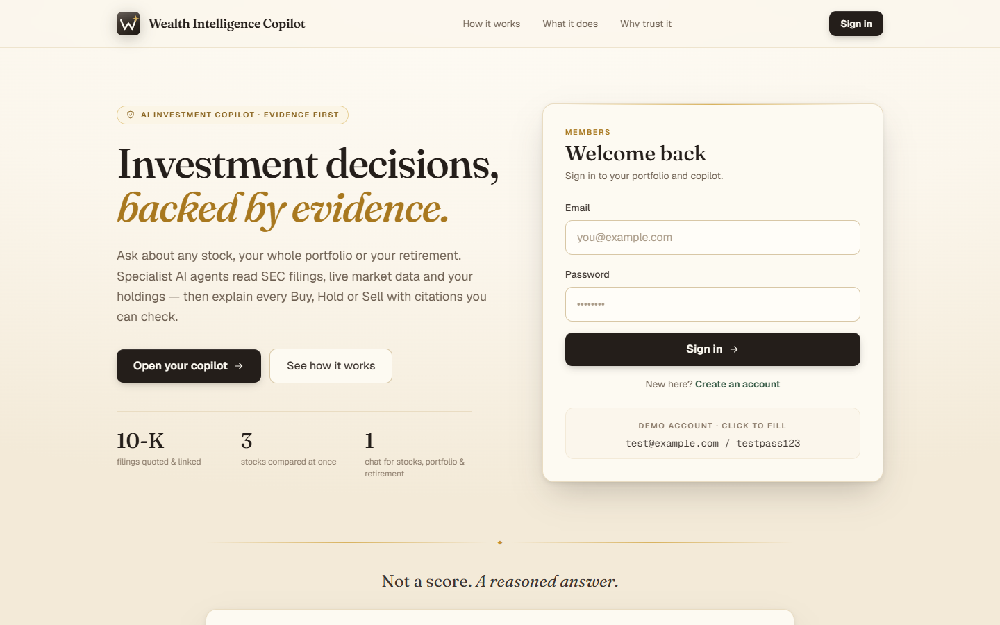
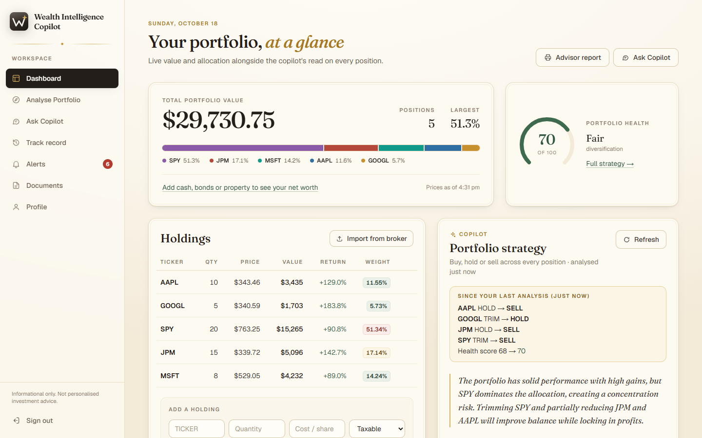
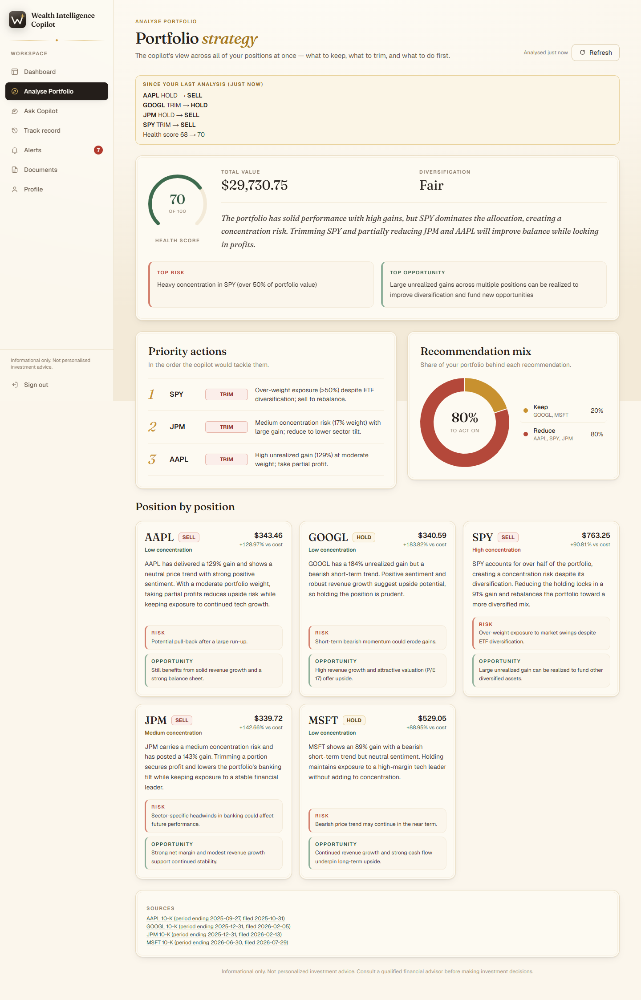
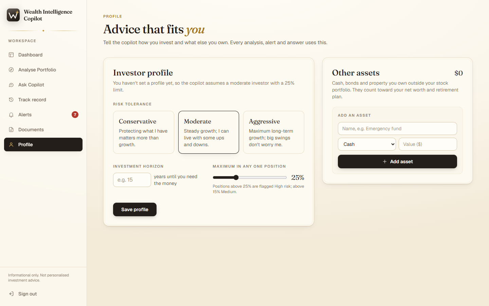
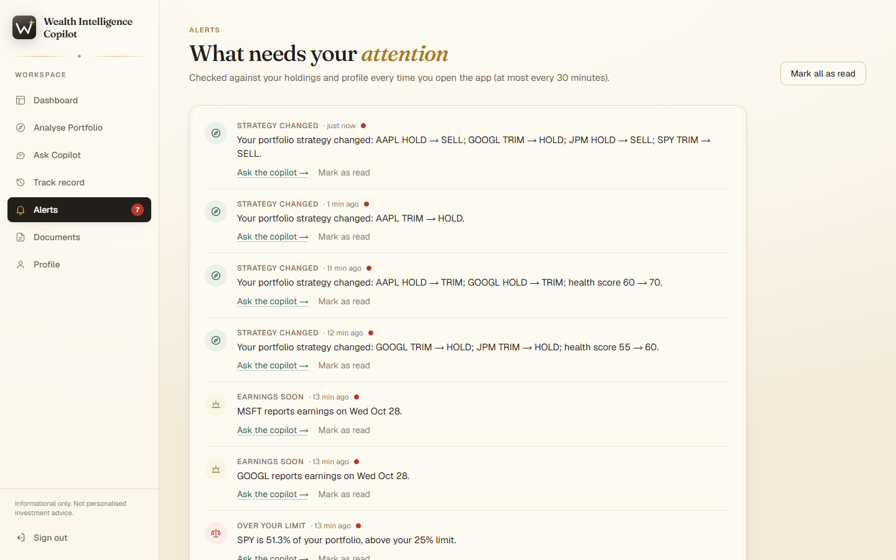
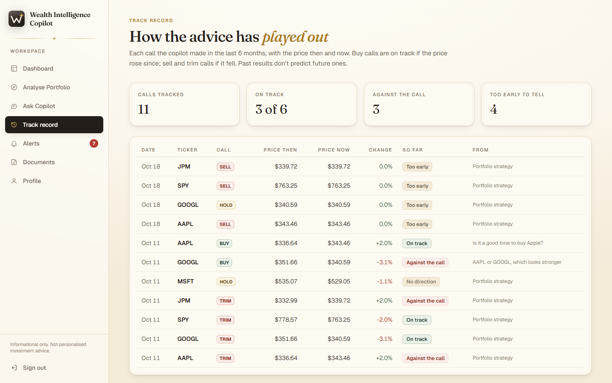
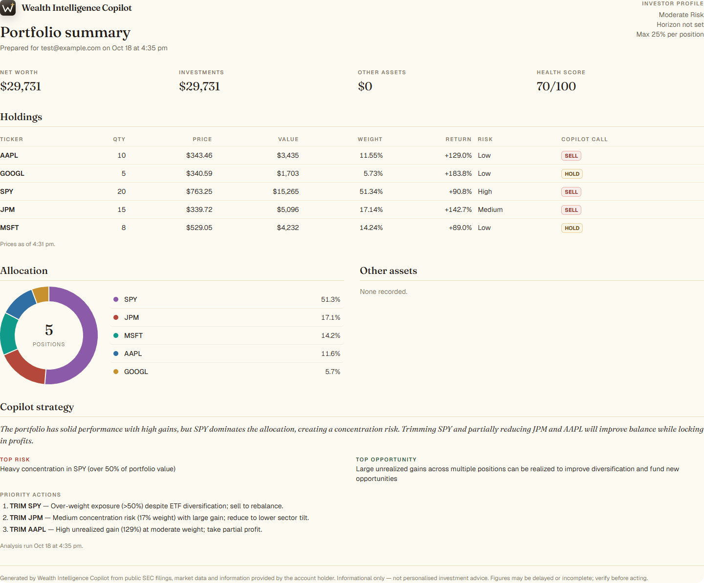
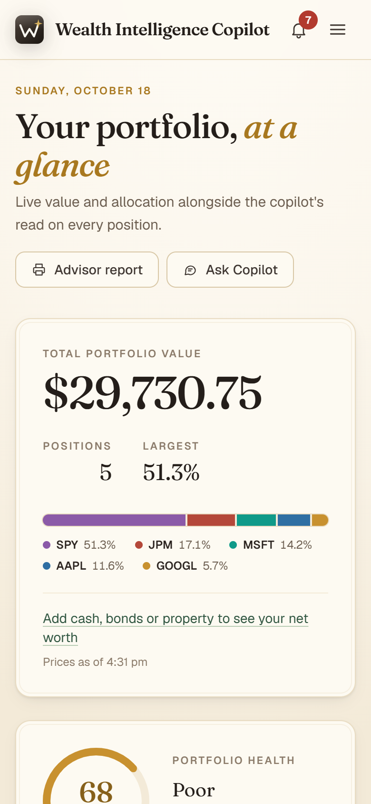

# Wealth Intelligence Copilot (WIC)

**An AI investment copilot that shows its work.** Ask about any stock, your whole portfolio or your retirement in plain English. Specialist AI agents read official SEC filings, live market data and your actual holdings, then explain every Buy, Hold or Sell with citations you can check, tailored to how *you* invest.



> **Try it locally:** follow the [Quick start](#quick-start), open `http://localhost:3000` and sign in with the demo account `test@example.com` / `testpass123` (five holdings, ready to analyse), or create your own account.

---

## Why WIC

Most investing tools give you either raw data or a confident one-word verdict. WIC sits in between: it does the analyst's homework and shows it.

| Benefit | How WIC delivers it |
|---|---|
| **Answers you can verify** | Every point is tagged with its source (e.g. *MSFT 10-K FY2026, Item 1A Risk Factors*) and links to the filing on SEC EDGAR. Figures come straight from the data feeds, never invented by the AI. |
| **Advice about *your* money, not "a stock"** | Recommendations account for what you already own, your risk tolerance, your time horizon and your own limit on any one position. |
| **Honest about uncertainty** | When the AI agents disagree, you're told and confidence drops. If the AI fails, you get an error, never a made-up answer. |
| **No jargon, no forms** | One chat for everything. "Should I buy more Apple?" works; no ticker codes or settings needed. |
| **A reason to come back** | Alerts on what changed, a "since your last analysis" summary, and a track record of how past advice played out. |
| **Less busywork** | Import holdings from your broker's export, see your whole net worth in one place, and print a one-page report for your advisor. |

---

## Features

### Ask Copilot: one chat for every question

The copilot works out what you're asking and which company you mean, so you never type ticker codes.

- **Single stocks**: *"Should I buy more Apple?"*, *"What are Microsoft's biggest risks?"* You get a direct answer, then a Buy / Hold / Sell view with positives, risks, key figures (price, revenue, growth, margin, P/E, your weight) and a confidence meter.
- **Comparisons**: *"AAPL or GOOGL, which looks stronger?"* Up to 3 stocks side by side with one verdict and the stronger pick highlighted.
- **Whole portfolio**: *"How healthy is my portfolio?"* A strategy across every position.
- **Retirement**: *"Can I retire at 60?"* Projections using your real portfolio, other assets and profile. It remembers details you've already given (age, income, goals) and never asks twice.
- **Follow-ups**: *"Should I sell it?"* reuses the stock from the conversation.
- **Starter questions** to get going, and a live timer while an answer is being prepared.

*Benefit: the research an analyst would do before a trade (read the filings, check the market, weigh it against what you hold), done in seconds and shown in full.*

### Dashboard: everything at a glance



- **Live portfolio value**, position count and largest position, with a colour-coded allocation bar.
- **Net worth**: investments plus cash, bonds and property from your profile.
- **Holdings table** with quantity, live price, value, return vs cost and weight, colour-coded against *your* concentration limits. Add or remove holdings inline.
- **Import from your broker**: upload a positions CSV export (common column names such as Symbol/Ticker, Quantity/Shares and Average cost/Cost basis are recognised, even below a broker's title lines; anything else goes to the AI) or a PDF statement (read by the AI). You review every row, untick any to skip, and choose to add to or replace your holdings. Nothing is saved until you confirm.
- **Concentration risk donut**: how much of your wealth rides on each position, each labelled High / Medium / Low against your own limit. Hover a slice for details.
- **Portfolio health score** and the AI strategy, which runs automatically and stays in sync with Analyse Portfolio.
- **Freshness labels**: "Prices as of 4:31 pm" and "analysed 3 min ago", so you always know how current the numbers are.

*Benefit: a two-minute check-in tells you what you own, what it's worth, where the risk is and what the copilot thinks, without opening a spreadsheet.*

### Analyse Portfolio: a strategy for every position



- **Health score** (0–100) with diversification rating, a one-paragraph summary, and the top risk and top opportunity.
- **Since your last analysis**: which calls changed (e.g. *GOOGL TRIM → HOLD*), new or removed tickers, and how the health score moved.
- **Priority actions**, ranked in the order the copilot would tackle them.
- **Recommendation mix donut**: how much of your portfolio the strategy asks you to add to, keep, reduce or rebalance ("57% to act on").
- **Position-by-position cards**: action, concentration level, price, return vs cost, reasoning, key risk and key opportunity.
- **Sources**: links to the 10-K filings used.

*Benefit: instead of judging each stock in isolation, you see the whole portfolio's balance and exactly what to do first.*

### Profile: advice that fits you



- **Risk tolerance** (conservative / moderate / aggressive), **investment horizon**, and **maximum position size**, the limit above which a position is flagged High risk (Medium starts at 60% of it).
- **Other assets**: cash, bonds, property and anything else you own outside your stock portfolio.
- These feed every recommendation, concentration label, alert and retirement answer. Until you set a profile, the copilot assumes a moderate investor with a 25% limit and says so.

*Benefit: a cautious 60-year-old and an aggressive 30-year-old get different advice for the same portfolio, as they should.*

### Alerts: know when something needs attention



In-app alerts (with an unread badge in the menu) when:

- a position goes **above your limit**,
- a holding **drops 5% or more** in a day,
- a company you own **files a new 10-K or 10-Q**,
- a company you own **reports earnings** within the next 14 days,
- your **portfolio strategy changes** (e.g. a Hold becomes a Sell).

Each alert links to a ready-made question (*"What changed in AAPL's latest SEC filing?"*) that opens in the chat for you to send. Checks run when you open the app (at most every 30 minutes) and never repeat the same alert.

*Benefit: you don't have to remember to check. The copilot tells you when it matters.*

### Track record: judge the advice for yourself



Every Buy / Hold / Sell call from the last 6 months with the price then, the price now and how it has played out so far: **On track**, **Against the call**, **Flat** or **Too early to tell**. Repeated identical calls are shown once, from when first made.

*Benefit: trust is earned. You can see whether the copilot's past calls held up before acting on new ones.*

### Advisor report: one page to share



A print-ready summary of your profile, net worth, holdings (with risk level and the copilot's call on each), allocation, other assets and the strategy. Use **Print / Save as PDF** to send it to your financial advisor or partner.

### Documents: bring your own research

Upload research notes or reports (PDF, TXT or CSV, up to 5 MB). When you ask about a company they mention, the relevant passages are cited alongside the SEC filings. Public filings are fetched automatically, so there's no need to upload those.

### Works on your phone



On small screens the sidebar becomes a menu button with the alerts bell always in reach.

### Audit trail

Every recommendation and strategy is logged server-side with the full answer, confidence and agent-agreement score (`GET /decisions/journal`). This powers the track record and "what changed" features.

---

## Quick start

**Prerequisites:** Docker Desktop, Python 3.11+, Node.js 18+

**1. Start the database**

    docker-compose up -d

Wait for `wealth_copilot_db (healthy)`. The schema is created on first run from `db/init.sql`, and any missing tables are also created when the backend starts.

**2. Configure and start the backend**

    cd backend
    copy .env.example .env        # then fill in the values (see Environment variables)
    python -m venv venv
    venv\Scripts\activate
    pip install -r requirements-dev.txt
    python -m app.seed
    uvicorn app.main:app --reload --port 8000

Wait for `Application startup complete`. Any startup warnings (missing keys, placeholder secrets) are printed above it.

**3. Start the frontend**

    cd frontend
    npm install
    npm run dev

Open `http://localhost:3000`.

`python -m app.seed` creates the demo user and 5 holdings (AAPL, GOOGL, SPY, JPM, MSFT) so the dashboard has data immediately. On Windows, `start-demo.bat` runs all three steps for you.

---

## Demo flow (10 minutes)

1. **Dashboard**: portfolio value, allocation and concentration donut. The AI strategy runs automatically on the right.
2. **Profile**: set your risk tolerance and a 20% position limit, and add some cash. Back on the dashboard, see net worth and the stricter risk labels.
3. **Ask Copilot**: click a starter question, or ask *"What are Microsoft's biggest risks?"*. You get a direct answer, key points tagged with their 10-K sections, key figures, and links to the filings.
4. Ask *"AAPL or GOOGL, which looks stronger?"* for a side-by-side comparison.
5. Ask *"How much more should I save to retire in 20 years?"* and answer its follow-up question. It won't ask again.
6. **Analyse Portfolio**: strategy across all positions, the recommendation mix, and what changed since your last analysis.
7. **Alerts**: see what the copilot has flagged; click *Ask the copilot* on one.
8. **Track record**: how earlier calls have played out.
9. **Dashboard → Import from broker**: upload a positions CSV and review the preview (you can cancel without saving).
10. **Dashboard → Advisor report**: print or save the one-page summary.

---

## How it works

```
question ──> Supervisor (LLM) ──┬─ stock(s) ──> Portfolio · Evidence · Market Data ──> Composer ──> answer
                                │                (in parallel, per stock)              (LLM)
                                ├─ portfolio ─> Portfolio Strategy Agent (LLM)
                                ├─ retirement > Retirement Agent (LLM)
                                └─ unclear ───> "Which stock do you mean?"

                 Investor profile + other assets feed every agent ─┘
```

| Agent | Type | Role |
|---|---|---|
| Supervisor | LLM | Classifies the question, picks the ticker(s) from names, holdings and chat history, and chooses the agents. Tickers are verified against your holdings or a live price before anything runs. |
| Portfolio Agent | Rule-based | Position weight and concentration risk from live market values, against your own position limit |
| Evidence Agent | LLM | Reasons over SEC financials, 10-K excerpts, news sentiment and your uploaded documents, citing a source for every signal |
| Market Data Agent | Rule-based | Reads today's price action: signal, momentum, position in the day's range |
| Recommendation Composer | LLM | Answers the question directly, then gives a buy/hold/sell view with positives, risks and citations, fitted to your investor profile |
| Portfolio Strategy Agent | LLM | Recommendation for every holding plus a health score, using your profile and other assets |
| Retirement Agent | LLM | Retirement projections using your real portfolio, other assets, profile and the conversation so far |

The portfolio and market-data agents were deliberately moved from LLM calls to plain code. They only restated numbers, so code is faster, exact, and saves AI rate-limit budget.

### Data sources

| Source | Used for |
|---|---|
| **SEC EDGAR** (free, no key) | 3 years of annual financials from XBRL data; latest 10-K / 10-Q (also drives filing alerts); Item 1A Risk Factors and Item 7 MD&A passages relevant to the question |
| **Finnhub** | Live quotes, daily moves, company profile, P/E, news headlines, earnings calendar |
| **Alpha Vantage** (optional) | Historical prices for correlation figures, only when requested |
| **Your documents** | Text extracted on upload; passages mentioning the company are cited |
| **Your broker files** | Holdings read from CSV exports (parsed directly) or PDF statements (read by the AI), always confirmed by you |

SEC data covers SEC-registered companies. ETFs such as SPY and some foreign issuers have no 10-K, and the answer says so.

### Guardrails

- **Evidence diversity score**: measures how much the agents agree. Below 0.4, confidence is capped and "Agents disagree" is shown. This is enforced in code, not just in the prompt.
- **Citations**: every key point carries its source, and the figures shown come straight from the data feeds, never from the LLM.
- **Numbers the AI can't override**: position weights and High/Medium/Low concentration levels are computed in code from live prices and your limits; the AI's own guesses are replaced.
- **No fake answers**: if the AI fails, you get a clear error. A placeholder recommendation is never shown or logged.
- **You stay in control of your data**: imported holdings are only saved after you review and confirm them.
- **Resilience**: empty or malformed AI replies are retried with a larger budget, short rate limits are waited out automatically, and alert checks keep working if one data provider is down.

### Performance

- Live prices are cached for 5 minutes and fetched in parallel; simultaneous requests for the same ticker share one fetch.
- The dashboard skips slow correlation calls; historical prices are cached for 12 hours when they are requested.
- SEC financials and market evidence are cached in the database (24 hours and 10 minutes respectively).
- Alert checks are throttled to once every 30 minutes per user.

---

## Environment variables

**Backend** (`backend/.env`, see `backend/.env.example`):

| Variable | Description |
|---|---|
| `DATABASE_URL` | PostgreSQL connection string. URL-encode special characters in the password (`@` → `%40`). |
| `JWT_SECRET` | 32+ characters, e.g. `python -c "import secrets; print(secrets.token_hex(32))"` |
| `GROQ_API_KEY` | From console.groq.com (LLM provider) |
| `FINNHUB_API_KEY` | From finnhub.io (quotes, news, profile, earnings calendar) |
| `ALPHA_VANTAGE_API_KEY` | From alphavantage.co (correlation data, optional) |
| `SEC_USER_AGENT` | `AppName your@email.com`. SEC requires a contact email and may block requests without one. |
| `CORS_ORIGINS` | Comma-separated frontend URLs allowed to call the API (default `http://localhost:3000`) |
| `TEST_DATABASE_URL` | Optional. Separate database for the test suite (default `wealth_copilot_test`). |

**Frontend** (`frontend/.env.local`, see `frontend/.env.example`):

| Variable | Description |
|---|---|
| `NEXT_PUBLIC_API_URL` | Backend URL (default `http://localhost:8000`) |

> **Groq free tier:** the free plan allows about 8,000 tokens per minute. A stock question uses a few thousand, so many questions in quick succession can hit the limit. The app shows *"The AI service is busy"* and recovers within a minute. A paid Groq plan removes this.

---

## Tests

**212 tests: 113 backend + 99 frontend.** Before deploying, run everything with one command from the project root (stop `npm run dev` first, since the build writes to the same `.next` folder):

    check.bat

It runs the backend tests, then the frontend typecheck, lint and tests, then a production build, and stops at the first failure. The same checks run on GitHub for every push and pull request (`.github/workflows/ci.yml`).

### Backend (pytest)

The backend tests run against a **separate** `wealth_copilot_test` database, which is created automatically and wiped on every run. The suite refuses to start if pointed at the app database. AI calls and market data are mocked, so no API keys are needed (Docker Postgres must be running).

| Suite | Tests | What it covers |
|---|---|---|
| test_auth.py | 9 | Signup, login, JWT validation, protected routes |
| test_portfolio.py | 7 | Holdings CRUD, data isolation between users |
| test_security.py | 5 | Token validation, SQL injection, input validation |
| test_guardrails.py | 6 | Evidence diversity scorer and confidence guardrail |
| test_decisions.py | 13 | Journal, evidence endpoints, cross-user security |
| test_sec.py | 7 | SEC parsing: annual figures, stale tags, 10-K sections, passage selection |
| test_fixes.py | 24 | Copilot routing (tickers, comparisons, clarifications), documents, LLM retries and rate limits |
| test_performance.py | 2 | Dashboard summary skips slow correlation calls; price history is cached |
| test_schema.py | 2 | `db/init.sql` and the SQLAlchemy models define the same tables and columns |
| test_profile.py | 9 | Profile defaults and validation, other assets, net worth, user limits in the agents |
| test_alerts.py | 9 | Each alert check, de-duplication, throttling, read state, provider failures, privacy |
| test_history.py | 8 | Strategy changes, track-record verdicts and condensing of repeated calls |
| test_import.py | 10 | Broker CSV formats, AI fallback for PDFs, preview → confirm, validation |
| test_personalisation.py | 2 | Profile and other assets reach the strategy and retirement agents |

    cd backend
    venv\Scripts\activate
    pytest -q

### Frontend (Vitest + React Testing Library)

Tests sit next to the code they cover (`*.test.ts` / `*.test.tsx`) and run in a simulated browser, with the backend mocked.

| Area | What it covers |
|---|---|
| `lib/ui`, `lib/charts`, `lib/chatSession`, `lib/time` | Money/percent formatting, risk thresholds, chart slices ("Other" folding, stable colours), chat history, freshness wording |
| Dashboard | Add-holding validation, holdings table, strategy panel states, concentration donut, broker import |
| Profile | Profile form, other assets |
| Alerts / Track record | Alert questions and read state, verdict labels and summary |
| Analyse Portfolio | Position cards, recommendation-mix donut, "since your last analysis" note |
| Landing / chat | Sign-in and sign-up flow, demo credentials, chat messages and answer cards |
| Donut chart | Legend values, hover and keyboard focus, accessibility labels |

    cd frontend
    npm test            # tests only
    npm run check       # typecheck + lint + tests

---

## API endpoints

| Endpoint | Method | Description |
|---|---|---|
| `/health` | GET | Service health check |
| `/auth/signup`, `/auth/login` | POST | Register / sign in, returns a JWT |
| `/auth/me` | GET | Current user profile |
| `/profile` | GET / PUT | Risk tolerance, horizon, max position size (and the derived concentration limits) |
| `/assets` | GET / POST | Other assets (cash, bonds, property) and their total |
| `/assets/{id}` | DELETE | Remove an asset |
| `/portfolio/holdings` | GET / POST | List / add holdings |
| `/portfolio/holdings/{id}` | DELETE | Remove a holding |
| `/portfolio/summary` | GET | Live prices, total value, net worth, the user's concentration limits, price freshness (`?include_correlation=true` adds correlation) |
| `/portfolio/import/preview` | POST | Read holdings from a broker CSV/PDF without saving |
| `/portfolio/import` | POST | Save confirmed holdings (`replace: true` swaps out existing ones) |
| `/decisions/ask` | POST | **Copilot chat.** Detects stock(s), portfolio or retirement, and answers with a `route` of `recommendation`, `comparison`, `strategy`, `retirement` or `clarify`. |
| `/decisions/query` | POST | Same as `/ask` but with an explicit `ticker` |
| `/decisions/portfolio-strategy` | GET | Strategy across all positions, with changes since the last one |
| `/decisions/retirement` | POST | Retirement analysis with conversation history |
| `/decisions/journal` | GET | Last 20 logged recommendations (audit trail) |
| `/decisions/track-record` | GET | Past calls with price then and now, and a verdict |
| `/alerts` | GET | Newest alerts and unread count (runs the market checks at most every 30 min) |
| `/alerts/read`, `/alerts/{id}/read` | POST | Mark all / one alert read |
| `/evidence/{ticker}` | GET | Raw market and news evidence for a ticker |
| `/documents/upload` | POST | Upload a PDF/TXT/CSV (max 5 MB) |
| `/documents/` | GET | List your documents |
| `/documents/{id}` | DELETE | Delete a document |

---

## Architecture

- **Frontend:** Next.js 16 (React 19) with Tailwind CSS 4; Vitest + React Testing Library
- **Backend:** FastAPI (Python 3.11), SQLAlchemy, LangGraph; pytest
- **Database:** PostgreSQL (pgvector image; Supabase-compatible). Schema in `db/init.sql`, checked against the models by a test.
- **LLM:** Groq: `openai/gpt-oss-20b` for fast calls, `openai/gpt-oss-120b` for synthesis
- **CI:** GitHub Actions runs every backend and frontend check on each push and pull request
- **Production target:** AWS (ECS Fargate, RDS, S3, Cognito, CloudWatch). Not yet implemented.

### Project layout

```
backend/app/
  api/            HTTP endpoints and request/response schemas (no business logic)
  agents/         Supervisor, specialist agents, composer and the LangGraph pipeline
  services/       Business logic and data sources (prices, SEC, news, profile, alerts, history, import)
  repositories/   Database queries, always scoped to the signed-in user
  models/         Database tables
  core/           Settings, database session, auth, startup checks
backend/tests/    pytest suites (see Tests)
frontend/app/     Pages (one folder per route) and components grouped by feature
frontend/lib/     API client, hooks, chart and formatting helpers
db/init.sql       Database schema, with every table and column explained
```

Every file starts with a comment explaining its job, and every backend function has a docstring. See [frontend/README.md](frontend/README.md) for the frontend's folder-by-folder guide.

---

## Security

- JWT authentication on every protected route. An expired session sends the user back to the login page.
- User data isolation enforced in every database query (holdings, profile, other assets, documents, alerts, journal), with tests proving one user can't read or change another's data
- Security headers on every response (X-Frame-Options, X-Content-Type-Options, Referrer-Policy, Permissions-Policy; HSTS over HTTPS)
- Input validation via Pydantic on every endpoint, including chat history, profile values, imports, and upload size and type
- CORS restricted to configured origins
- Startup self-check warns about placeholder secrets, missing API keys and a missing SEC contact email

---

## Known limitations

- **Not financial advice.** WIC is a decision-support tool; its analysis can be incomplete or wrong.
- **AI calls can vary between runs.** Re-running the strategy minutes apart can change some calls or move the health score a few points. The track record keeps only each day's final call, and "since your last analysis" makes changes visible.
- **US-listed companies only** for SEC data; ETFs have no 10-K.
- **Alerts are in-app only** (no email yet) and are checked when you open the app rather than on a schedule.
- **Security hardening still to do:** the login token is stored in browser `localStorage` (an httpOnly cookie would be safer), and the API has no request rate limiting of its own.

---

## Specification documents

- Document 1: Product Vision and Business Requirements
- Document 2: Software Requirements Specification
- Document 3: Solution Architecture Document with C4 diagrams
- Document 4: Technical Design and Developer Guide
